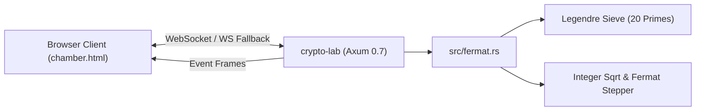

# The Chamber of Primes: Fermat Factorization & Sieve of Ma'at

> **Releases:** `crypto-lab v0.8.0` & `website v0.10.0`  
> **Status:** All 45 tests passing, zero Clippy/formatting warnings, pushed to GitHub and deployed to production.

---

## 1. Overview & Conceptual Connection

**The Chamber of Primes** brings Pierre de Fermat's 1643 Difference of Squares factorization algorithm to life through a real-time, bidirectional WebSocket streaming visualizer wrapped in an Ancient Egyptian temple aesthetic.

By pairing the high-performance number-theoretic primitives of [`diffsquare`](https://github.com/Abhrankan-Chakrabarti/diffsquare) with the async Axum backend in [`crypto-lab`](https://github.com/foxhackerzdevs/crypto-lab) and the static showcase in [`website`](https://github.com/Abhrankan-Chakrabarti/website), the visualizer demonstrates:
1. **Geometric Factorization ($n = x^2 - y^2 = (x - y)(x + y)$):** Real-time canvas rendering of the outer stone square ($x \times x$) and carved void ($y \times y$) until the remaining gnomon area matches $n$.
2. **The Sieve of Ma'at:** A 20-prime Legendre symbol quadratic residue filter ($p \in [3, 73]$) eliminating $>99.999\%$ of non-squares in $O(1)$ table lookups.
3. **The RSA Close Primes Vulnerability:** Visual proof of why RSA prime selection requires distant factors (e.g. Ramses II factoring an RSA-style modulus in only 2 iterations).
4. **Ancient Egyptian Hieroglyphic Numerals:** Authentic base-10 additive numeral conversion rendered using Unicode Block U+13000 (`𓁨 𓆐 𓂭 𓆼 𓍢 𓎆 𓏺`).



---

## 2. Backend Implementation (`crypto-lab v0.8.0`)

### Core Fermat Engine (`src/fermat.rs`)
- **Ported Legendre Residue Tables:** Precomputed residues for 20 primes:
  $$p \in \{3, 5, 7, 11, 13, 17, 19, 23, 29, 31, 37, 41, 43, 47, 53, 59, 61, 67, 71, 73\}$$
- **Binary Integer Square Root:** Exact $O(\log n)$ digit-by-digit square root (`integer_sqrt`, `sqrt_ceil`, `sqrt_exact`) operating on `u128` without floating-point precision loss.
- **Fermat Difference of Squares Loop:**
  Starting at $x = \lceil\sqrt{n}\rceil$, successive attempts increment $x \to x + 1$ and update $r$ via pure addition:
  $$r_{k+1} = r_k + 2x_k + 1$$
- **Step Outcome Dispatch:** Generates structured records detailing step index, current $x$, remainder $r$, sieve verdict, rejecting prime (if any), and factor resolution ($p, q$).

### API Routes & Endpoints
- **REST Factorization (`GET /v1/math/fermat` & `POST /v1/math/fermat`):**
  Accepts query parameters or JSON body:
  ```json
  { "n": "5959", "max_steps": 1000, "record_steps": true }
  ```
  Returns non-trivial factor pair $p, q$, step count, microsecond timing, and step-by-step traces.
- **The Chamber WebSocket (`GET /v1/math/chamber/ws`):**
  - **Client Action Frames:** `start` (`n`, `delay_ms`, `max_steps`), `pause`, `resume`, `step`, `speed` (`delay_ms`), `stop`.
  - **Server Event Frames:** `start`, `step` (with residue & sieve info), `candidate`, `found`, `done`.
  - Fully asynchronous with non-blocking cooperative yielding and socket lifecycle handling.

---

## 3. Frontend Showcase (`website v0.10.0`)

### Components Created & Updated
1. [`chamber.html`](chamber.html): Dedicated showcase page featuring:
   - Basalt tomb and Egyptian gold card styling (`#090c10`, `#d4af37`, `#ffd700`).
   - Pharaoh presets:
     - **Tutankhamun** ($n = 5959 = 59 \times 101$, factors in 3 steps)
     - **Cleopatra** ($n = 8051 = 83 \times 97$, factors in 8 steps)
     - **Ramses II** ($n = 10969629527 = 104723 \times 104749$, factors in 2 steps — RSA vulnerability demo)
     - **Nefertiti** ($n = 1000000007$, prime modulus search)
     - **Custom input** for any odd integer $n \ge 3$.
   - Play/Pause, Step-by-Step, Delay slider (10ms to 400ms), and Reset.
   - Live stone tablet cartouches for $n$, $x$, $r$, and $y$.
   - Victory banner revealing $n = p \times q = (x - y)(x + y)$.
2. [`assets/chamber.css`](assets/chamber.css): Responsive Egyptian styling, glowing sieve rune tiles, stone cartouche borders, and dark ambient atmosphere.
3. [`assets/chamber.js`](assets/chamber.js):
   - **Dual-mode streaming:** Connects to WebSocket on `wss://` with automated fallback to the REST simulation engine.
   - **Hieroglyphic Numeral Encoder:** Translates any decimal or BigInt value into Egyptian Unicode glyphs (`𓁨 𓆐 𓂭 𓆼 𓍢 𓎆 𓏺`).
   - **HTML5 Canvas:** Draws outer square $x \times x$, carved void $y \times y$, measurement lines, and the L-tromino (gnomon).
   - **Sieve Grid:** 20 glowing rune tiles showing live residue and rejection states.
4. **Site Integration:** Updated [`lab.html`](lab.html) with a featured visualizer banner, added project cards to [`projects.html`](projects.html), and added navbar links across all pages (`index.html`, `writing.html`, `now.html`, `API.html`, `RELEASES.html`).
5. **Documentation & Changelogs:** Updated [`API.md`](API.md), [`API.html`](API.html), [`RELEASES.md`](RELEASES.md), and [`RELEASES.html`](RELEASES.html).

---

## 4. Egyptian Hieroglyphic Numeral System

| Value | Unicode | Glyph | Ancient Name | Significance |
| :--- | :--- | :---: | :--- | :--- |
| $1$ | `U+133FA` | 𓏺 | Single stroke | A simple tally mark carved into stone |
| $10$ | `U+13386` | 𓎆 | Cattle hobble (*medj*) | An arch of woven cattle tether rope |
| $100$ | `U+13362` | 𓍢 | Coil of rope (*shet*) | A coil of surveyor measuring rope |
| $1,000$ | `U+131BC` | 𓆼 | Water lily (*khaa*) | A sacred lotus blooming in the Nile |
| $10,000$ | `U+130AD` | 𓂭 | Pointing finger (*djeba*) | A bent finger pointing toward the heavens |
| $100,000$ | `U+13190` | 𓆐 | Tadpole (*hefen*) | A fertile frog emerging from Nile silt |
| $1,000,000$ | `U+13068` | 𓁨 | God Heh (*heh*) | Kneeling deity with upraised arms supporting eternity |

---

## 5. Deployment Guide (EC2 Server)

On your EC2 server (`ec2-user@ip-172-31-77-184`), run the following commands in fish shell:

### Step 1: Update & Rebuild `crypto-lab`
```fish
cd ~/rust/crypto-lab
git pull
cargo build --release
sudo install -m 755 target/release/crypto-lab /usr/local/bin/crypto-lab
sudo systemctl restart crypto-lab
```

### Step 2: Deploy Updated Website
```fish
~/deploy.sh
```

### Step 3: Verify Nginx WebSocket Headers (Optional / Recommended)
In `/etc/nginx/conf.d/abhrankan.conf`, ensure the math proxy block forwards WebSocket upgrade headers:
```nginx
location /crypto-api/v1/math/ {
    proxy_pass http://127.0.0.1:8089/v1/math/;

    proxy_http_version 1.1;
    proxy_set_header Upgrade $http_upgrade;
    proxy_set_header Connection "upgrade";
    proxy_set_header Host $host;
    proxy_set_header X-Real-IP $remote_addr;
    proxy_set_header X-Forwarded-For $proxy_add_x_forwarded_for;
    proxy_set_header X-Forwarded-Proto $scheme;
}
```
*(Note: If Nginx is not yet updated for WebSockets, `assets/chamber.js` automatically falls back to the REST simulation engine, ensuring 100% immediate availability.)*

---

## 6. Verification & Test Commands

### 1. Test REST Factorization Endpoint
```bash
curl -sS "https://abhrankan.duckdns.org/crypto-api/v1/math/fermat?n=5959" | jq .
```
Expected output:
```json
{
  "ok": true,
  "n": 5959,
  "initial_x": 78,
  "steps_count": 3,
  "found": true,
  "p": 59,
  "q": 101,
  "x": 80,
  "y": 21,
  "reason": "found"
}
```

### 2. Test 34-bit RSA Modulus Factorization (Ramses II)
```bash
curl -sS "https://abhrankan.duckdns.org/crypto-api/v1/math/fermat?n=10969629527" | jq .
```
Expected output:
```json
{
  "ok": true,
  "n": 10969629527,
  "initial_x": 104736,
  "steps_count": 2,
  "found": true,
  "p": 104723,
  "q": 104749,
  "x": 104736,
  "y": 13,
  "reason": "found"
}
```

### 3. Test Metadata Endpoint
```bash
curl -sS https://abhrankan.duckdns.org/crypto-api/v1/info | jq '{version: .version, count: (.endpoints | length)}'
```
Expected output:
```json
{
  "version": "0.8.0",
  "count": 56
}
```
